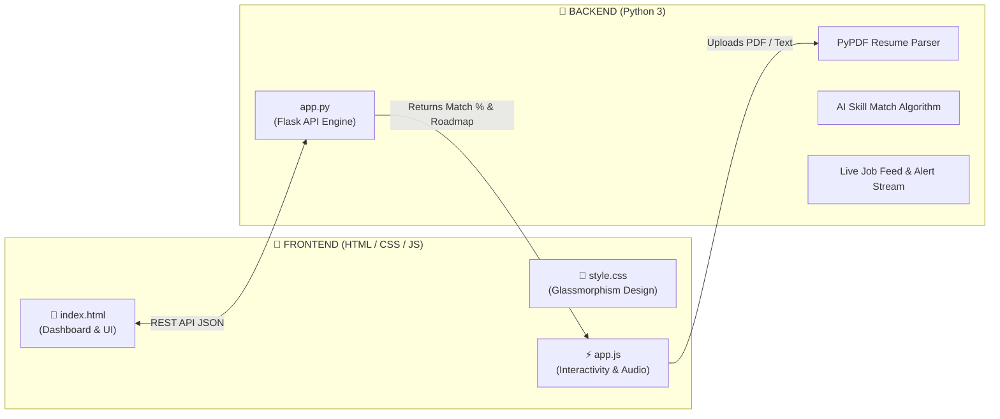

# 🚀 HireSense AI — Dual Architecture (HTML Frontend + Python AI Backend)

> **Tagline:** *“Find Your Match. Build Your Skills. Get Career-Ready.”*  
> **Tech Stack:** **HTML5, CSS3, JavaScript** (Frontend) + **Python Flask & PyPDF** (AI Backend)

---

## 🏗️ How HTML and Python Work Together (Dual Architecture)

### 1. 🎨 Frontend Files (HTML / CSS / JS)
- [`index.html`](./index.html): Clean modern responsive web page containing all 5 stages (Dashboard, Profile Upload, AI Job Matcher, Skill Gap & 4-Week Roadmap, Live Vacancies).
- [`static/css/style.css`](./static/css/style.css): Professional styling, cards, status pills, dark modern theme, and animations.
- [`static/js/app.js`](./static/js/app.js): Handles UI clicks, 1-click sample profiles, resume file drag & drop, Web Audio API chime sound, and real-time alert pop-ups.

### 2. 🐍 Backend Files (Python)
- [`app.py`](./app.py): Python Flask server providing RESTful endpoints:
  - `POST /api/parse_resume`: Extracts skills and text from PDF resumes using `pypdf`.
  - `POST /api/analyze_matches`: Calculates match percentages against vacancies and generates personalized 4-week roadmaps.
  - `GET /api/jobs`: Returns live vacancy listings with search and domain filtering.
  - `POST /api/simulate_new_job`: Streams urgent incoming job vacancies to trigger live alerts.
- [`test_app.py`](./test_app.py): Automated unit test suite verifying all 7 endpoints.

---

## 🚀 2 Easy Ways to Open & Use the Project

### Way 1: Full-Stack Mode (Python Server + HTML UI) ⭐ Recommended
1. Run `run.bat` (or in terminal: `python app.py`).
2. Open your web browser and go to:
   👉 **`http://127.0.0.1:5000`**
3. Both the Python AI server and the HTML frontend work together seamlessly!

### Way 2: Direct HTML File (Double-Click in Explorer)
1. Go to the project folder: `C:\Users\GKM\.gemini\antigravity\scratch\hiresense-ai\`
2. Just double-click **`index.html`**!
3. It will open directly in Chrome, Edge, or Firefox with full client-side matching, live job alerts, and resume analyzer ready!

---

## 💎 Five Core Features

1. **AI Job Matcher:** Compares student skills with live vacancy requirements and displays score percentage (e.g. 85% match).
2. **Real-Time Job Feed:** Live vacancies with category filter (Frontend, AI & Data, Full Stack, Backend, DevOps).
3. **Resume Analyzer:** Upload PDF or paste text to extract technical skills automatically.
4. **Skill Gap Analyzer:** Visually breaks down **"Skills You Have"** vs **"Skills You Need to Learn"**.
5. **AI Career Assistant:** 4-Week learning roadmap, ATS resume tips, and top interview questions.
6. **Live Job Alert with Audio Chime:** Sound chime + pop-up notification banner when new vacancies arrive.
